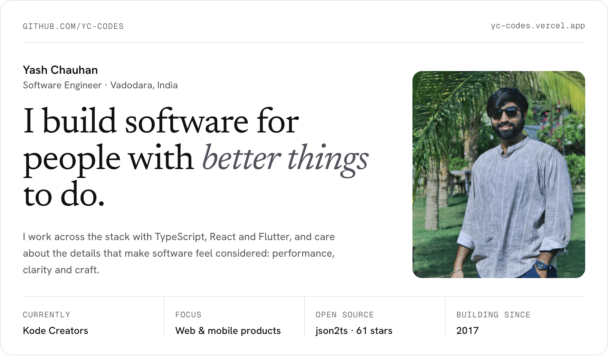
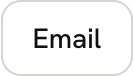
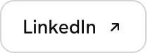
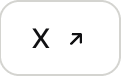
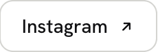
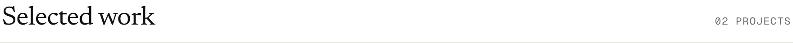
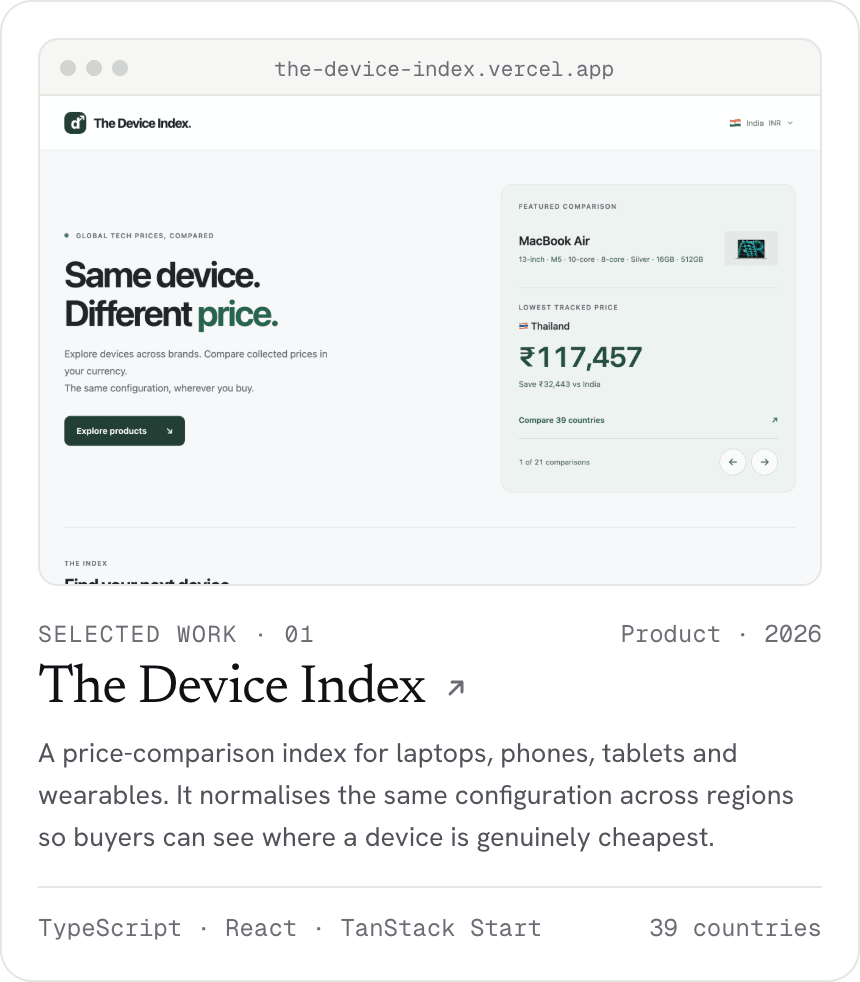
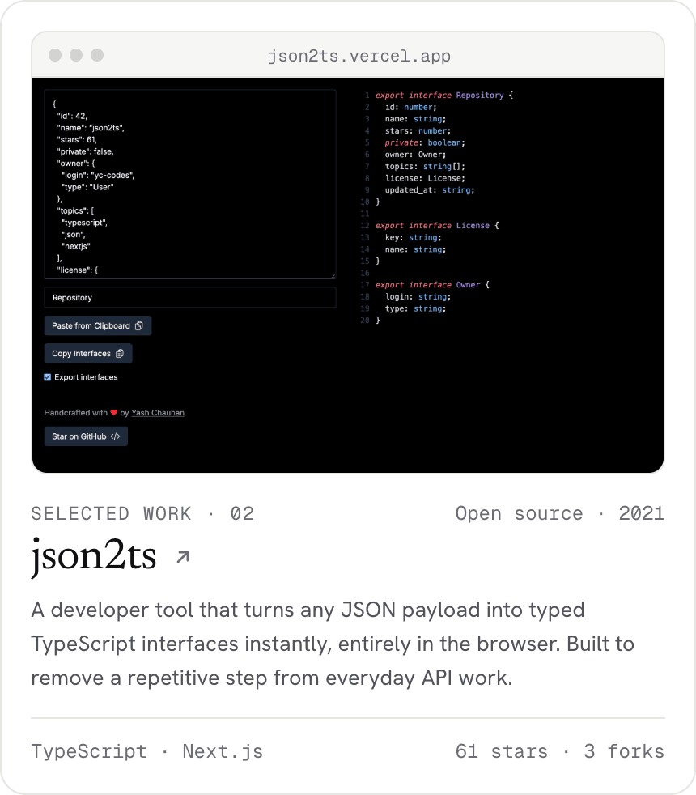
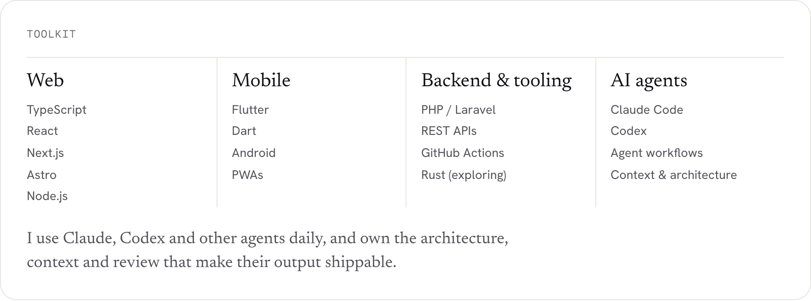

<a href="https://yc-codes.vercel.app"><picture><source media="(prefers-color-scheme: dark)" srcset="assets/header-dark.png"></picture></a>

<a href="https://yc-codes.vercel.app"><picture><source media="(prefers-color-scheme: dark)" srcset="assets/b-portfolio-dark.png"></picture></a>
<a href="mailto:yash@kodecreators.com"><picture><source media="(prefers-color-scheme: dark)" srcset="assets/b-email-dark.png"></picture></a>
<a href="https://www.linkedin.com/in/yc9274"><picture><source media="(prefers-color-scheme: dark)" srcset="assets/b-linkedin-dark.png"></picture></a>
<a href="https://x.com/yc_codes"><picture><source media="(prefers-color-scheme: dark)" srcset="assets/b-x-dark.png"></picture></a>
<a href="https://www.instagram.com/yc_codes"><picture><source media="(prefers-color-scheme: dark)" srcset="assets/b-instagram-dark.png"></picture></a>

 

<picture><source media="(prefers-color-scheme: dark)" srcset="assets/h-work-dark.png"></picture>

<a href="https://the-device-index.vercel.app"><picture><source media="(prefers-color-scheme: dark)" srcset="assets/c-device-dark.png"></picture></a>
<a href="https://json2ts.vercel.app"><picture><source media="(prefers-color-scheme: dark)" srcset="assets/c-json-dark.png"></picture></a>

<a href="https://github.com/yc-codes/the-device-index">The Device Index source</a> · <a href="https://github.com/yc-codes/json-2-ts">json2ts source</a> · <a href="https://github.com/yc-codes/rainbow">rainbow</a> · <a href="https://github.com/yc-codes/vscode-react-lazy-imports">vscode-react-lazy-imports</a> · <a href="https://github.com/yc-codes/nushell-build">nushell-build</a> · <a href="https://github.com/yc-codes/github-flutter">github-flutter</a>

  

<picture><source media="(prefers-color-scheme: dark)" srcset="assets/toolkit-dark.png"></picture>

  

<picture><source media="(prefers-color-scheme: dark)" srcset="assets/footer-dark.png"></picture>

